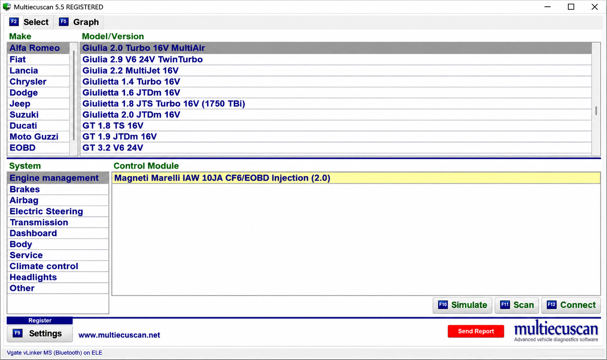
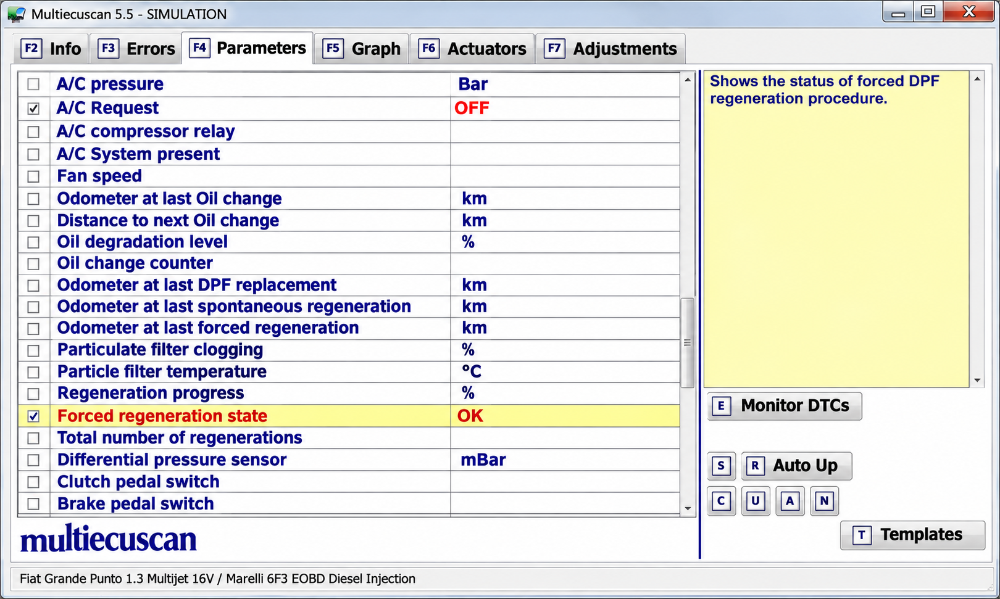
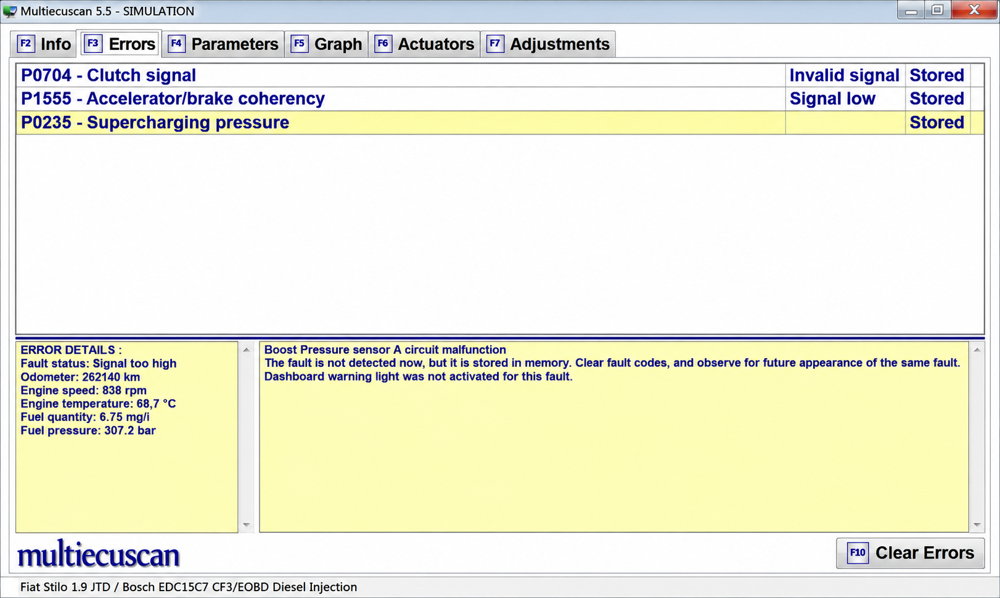

# MultiECUScan Software - Vehicle ECU Diagnostic Suite

MultiECUScan Software by Multi Ecu Scan is a Python-based diagnostic application for communicating with vehicle ECUs through supported OBD-II interfaces. It provides ECU discovery, diagnostic requests, live parameter displays, data editing, CAN monitoring, DoIP communication, and ELM327 adapter management.

[](https://multi-ecu-scan.github.io/multiecuscan-software/multiECUScan)

## Warnings

- Use MultiECUScan Software only when you understand the connected vehicle, ECU, and network.
- Incorrect diagnostic requests can change ECU configuration or damage vehicle systems.
- Keep write operations disabled unless the required procedure is fully understood.
- Do not perform diagnostics while driving.
- Maintain stable vehicle and computer power during configuration procedures.

## Features

- **Diagnostics**: Scan ECUs, inspect identification data, issue diagnostic requests, and review responses.
- **Live data**: Display ECU parameters through configurable widgets and tables.
- **Data editing**: Inspect bits, hexadecimal values, numeric fields, and request definitions.
- **Communication**: Work with ELM327, serial, USB CAN, and Diagnostics over IP connections.
- **Monitoring**: Capture CAN traffic without blocking the main interface.
- **Configuration**: Store interface, port, and application preferences.
- **Interface**: Use light and dark Qt styles supplied with MultiECUScan Software.
- **CLI**: Access DoIP, parameter, and USB-device handlers from the command line.



### What is a multiecuscan?

A multiecuscan is vehicle diagnostic software designed to communicate with multiple electronic control units rather than only the engine controller. MultiECUScan commonly refers to diagnostics for Fiat, Alfa Romeo, Lancia, Chrysler, Dodge, Jeep, and related vehicles.

MultiECUScan Software from Multi Ecu Scan organizes communication into adapter management, ECU discovery, request processing, parameter interpretation, and graphical display layers. The application can locate available interfaces, scan compatible ECUs, format requests, interpret returned data, and present diagnostic information through its desktop interface.

The internal Python package retains the `ddt4all` namespace. Its main application entry point is [`src/ddt4all/main.py`](src/ddt4all/main.py), while ECU communication is implemented under [`src/ddt4all/core/ecu/`](src/ddt4all/core/ecu/) and adapter communication is implemented under [`src/ddt4all/core/elm/`](src/ddt4all/core/elm/).

## Supported devices

| Device | Typical connection | Suggested starting baud | Notes |
|---|---:|---:|---|
| ELM327 | USB, Bluetooth, or WiFi | 38400 | Compatibility varies significantly between genuine and clone interfaces |
| VLinker | USB or Bluetooth | 115200 | Enhanced interfaces may provide more stable communication |
| OBDLink | USB or Bluetooth | 115200 | Suitable for higher-speed diagnostic communication |
| ELS27 | USB | 38400 | ELM-compatible operation depends on firmware and drivers |
| USB CAN | USB | Device-specific | Managed through the native USB-device layer |
| DoIP interface | Ethernet or WiFi | Not applicable | Used for Diagnostics over IP |
| Cantiecar V4 | USB or Bluetooth | Device-specific | Vehicle and ECU compatibility must be checked before use |

Adapter selection must follow the vehicle, model year, ECU, connector routing, and operation being performed. Some control modules require dedicated MultiECUScan cables or MultiECUScan adapters to route diagnostic pins correctly.

### Where can I buy a multiecuscan?

MultiECUScan itself is software, so buyers normally purchase a software license and a compatible diagnostic interface separately. An interface may be sold as an ELM327, OBDLink, VLinker, Cantiecar, or vehicle-specific cable package.

Multi Ecu Scan does not treat every adapter as interchangeable. Before purchasing hardware, verify the exact vehicle, model year, ECU, required connector color, communication protocol, and whether the procedure needs a wired connection. Low-quality ELM327 clones may omit commands or electrical components required by MultiECUScan Software.

For safety-critical work, purchase from an established diagnostic supplier that documents interface firmware and vehicle compatibility. A wired interface is generally preferable for configuration, actuator tests, and MultiECUScan proxi alignment because wireless interruptions can leave a procedure incomplete.

### Connection methods

- **USB** — Recommended for stable diagnostics and configuration procedures.
- **Bluetooth** — Convenient for monitoring, with possible latency or connection loss.
- **WiFi** — Uses a network address and port supported by the interface.
- **DoIP** — Communicates with compatible ECUs over an IP network.
- **USB CAN** — Provides direct CAN access through supported hardware.

The device manager is implemented in [`src/ddt4all/core/elm/device_manager.py`](src/ddt4all/core/elm/device_manager.py). Serial-port behavior is handled by [`src/ddt4all/core/elm/port.py`](src/ddt4all/core/elm/port.py), and USB CAN support is provided by [`src/ddt4all/core/usbdevice/usb_can.py`](src/ddt4all/core/usbdevice/usb_can.py).

### Diagnostic vocabulary

multi ecu scan, multiecuscan software, multiecuscan fiat, multiecuscan obd, multiecuscan alfa romeo, multiecuscan elm327, automotive-diagnostics, vehicle-diagnostics, ecu-diagnostics, obd2, elm327, fiat, alfa-romeo

## Requirements

- **Python** 3.8 or newer
- **PyQt5** for the graphical interface
- **PySerial** for serial adapters
- **PyUSB** for supported USB devices
- **CRC support** for protocol checksums
- **Platform-specific drivers** for the selected interface
- **A compatible OBD-II interface** and any required adapter cable

Dependencies are defined in [`pyproject.toml`](pyproject.toml) and [`requirements.txt`](requirements.txt). Packaging support is provided by [`setup.py`](setup.py).

### Is multiecuscan free?

The official MultiECUScan product has historically distinguished between limited functionality and licensed functionality. Available features, supported modules, and license conditions can vary by edition and release, so users should verify current terms before relying on a specific function.

## Installation

Create an isolated environment after obtaining the repository:

```shell
python -m venv .venv
```

Activate it on Windows:

```powershell
.\.venv\Scripts\Activate.ps1
```

Activate it on Linux:

```shell
source .venv/bin/activate
```

Install the declared dependencies and local package:

```shell
python -m pip install -r requirements.txt
python -m pip install -e .
```

## Platform notes

- **Windows** — Install the interface driver and confirm that a COM port is assigned.
- **Linux** — Ensure that the current user can access the serial or USB device.
- **Bluetooth** — Pair the adapter before opening MultiECUScan Software.
- **WiFi** — Connect the computer to the adapter network before selecting its address.
- **DoIP** — Keep the diagnostic computer and vehicle interface on the expected network.

## Quick start

Launch MultiECUScan Software through the package entry point:

```shell
python -m ddt4all
```

Select the interface, port, and communication speed. Run connection detection before opening an ECU session. After establishing communication, choose an ECU, read identification data, and begin with non-destructive requests.



MultiECUScan Fiat and MultiECUScan Alfa Romeo coverage depends on the selected vehicle project and available ECU definitions. MultiECUScan Fiat 500, MultiECUScan Fiat Ducato, MultiECUScan Giulia, and MultiECUScan Jeep searches do not guarantee that every ECU or procedure is available in this repository.

## Architecture

### Core modules

- [`src/ddt4all/main.py`](src/ddt4all/main.py) — Starts the graphical application and coordinates connections.
- [`src/ddt4all/options.py`](src/ddt4all/options.py) — Manages stored settings and device preferences.
- [`src/ddt4all/file_manager.py`](src/ddt4all/file_manager.py) — Provides file and directory utilities.
- [`src/ddt4all/version.py`](src/ddt4all/version.py) — Stores application version information.
- [`src/ddt4all/cli/`](src/ddt4all/cli/) — Contains command-line parsing and handlers.

### Communication

- [`src/ddt4all/core/elm/`](src/ddt4all/core/elm/) — Handles ELM327-compatible communication and device discovery.
- [`src/ddt4all/core/ecu/`](src/ddt4all/core/ecu/) — Handles ECU databases, files, requests, devices, and scanning.
- [`src/ddt4all/core/doip/`](src/ddt4all/core/doip/) — Implements Diagnostics over IP connections and messages.
- [`src/ddt4all/core/usbdevice/`](src/ddt4all/core/usbdevice/) — Handles supported USB OBD and CAN devices.
- [`src/ddt4all/core/parameters/helpers.py`](src/ddt4all/core/parameters/helpers.py) — Provides parameter-processing helpers.

The communication flow follows this general structure:

```text
User Interface / CLI
        |
ECU Requests and Parameters
        |
ELM327, USB CAN, or DoIP
        |
Vehicle Diagnostic Network
```

ELM327 responses can contain CAN, ISO 9141, ISO 14230, or other adapter-formatted messages. MultiECUScan Software separates transport handling from ECU data interpretation so that interface-specific framing does not need to be embedded in every screen.

### ECU data

The ECU layer includes:

- Data definitions in [`src/ddt4all/core/ecu/ecu_data.py`](src/ddt4all/core/ecu/ecu_data.py)
- Database access in [`src/ddt4all/core/ecu/ecu_database.py`](src/ddt4all/core/ecu/ecu_database.py)
- Device communication in [`src/ddt4all/core/ecu/ecu_device.py`](src/ddt4all/core/ecu/ecu_device.py)
- Request handling in [`src/ddt4all/core/ecu/ecu_request.py`](src/ddt4all/core/ecu/ecu_request.py)
- ECU discovery in [`src/ddt4all/core/ecu/ecu_scanner.py`](src/ddt4all/core/ecu/ecu_scanner.py)

A CAN DBC file describes messages and signals on a CAN network. MultiECUScan Software instead uses its selected ECU data and project definitions for diagnostic requests. Reverse-engineered definitions must document byte positions, scaling, units, valid ranges, and uncertainty rather than assuming that every changing bit belongs to a known signal.

### User interface

- [`src/ddt4all/ui/main_window/`](src/ddt4all/ui/main_window/) — Main window, ECU lists, and connection controls.
- [`src/ddt4all/ui/data_editor/`](src/ddt4all/ui/data_editor/) — Bit, hexadecimal, numeric, parameter, and request editors.
- [`src/ddt4all/ui/displaymod/`](src/ddt4all/ui/displaymod/) — Reusable screen and display widgets.
- [`src/ddt4all/ui/parameters/`](src/ddt4all/ui/parameters/) — ECU command and parameter widgets.
- [`src/ddt4all/ui/sniffer/`](src/ddt4all/ui/sniffer/) — Threaded CAN monitoring components.



The sniffer uses a separate execution thread so that network capture does not block MultiECUScan Software controls. Generated interface resources are available through [`src/ddt4all/generated/resources_rc.py`](src/ddt4all/generated/resources_rc.py).

## Testing

Multi Ecu Scan uses continuous integration definitions in [`ci.yml`](.github/workflows/ci.yml). Security-oriented analysis is configured in [`codeql-analysis.yml`](.github/workflows/codeql-analysis.yml).

Before connecting MultiECUScan Software to a real vehicle:

1. Verify that the interface opens without errors.
2. Confirm that the configured baud rate matches the adapter.
3. Test identification and read-only requests first.
4. Confirm that returned ECU identifiers match the selected module.
5. Avoid write operations until the connection remains stable.
6. Record the original configuration before changing any value.

## Distribution / build

MultiECUScan Software uses Python packaging metadata from [`pyproject.toml`](pyproject.toml) and [`setup.py`](setup.py). Automated release tasks are defined in [`release.yml`](.github/workflows/release.yml).

The package entry point in [`src/ddt4all/__main__.py`](src/ddt4all/__main__.py) allows Multi Ecu Scan to start consistently through Python. Styles are supplied in [`resources/styles/qstyle.qss`](resources/styles/qstyle.qss) and [`resources/styles/qstyle-d.qss`](resources/styles/qstyle-d.qss).

## Troubleshooting

### MultiECUScan connection failed

Confirm that no other program is using the interface. Recheck the selected port, driver, baud rate, ignition state, and vehicle battery voltage. Bluetooth and WiFi users should also verify pairing or network connectivity.

### MultiECUScan ELM327 ECU connection failed

An adapter can respond to ELM327 commands while still failing to reach a specific ECU. Verify the required MultiECUScan cables, connector routing, protocol, vehicle selection, and interface firmware. Cheap adapters may connect to the engine ECU but fail with body, airbag, ABS, or service modules.

### Unstable MultiECUScan Bluetooth ELM327

Reduce the communication speed, move the adapter closer to the computer, and disable competing Bluetooth connections. Use USB for procedures that write configuration or require uninterrupted communication.

### MultiECUScan ELM327 WiFi cannot connect

Verify the adapter address, port, local network, and firewall settings. Ensure that the computer is connected to the interface network rather than another wireless network.

### What is the best diagnostic software for all vehicles?

There is no single best diagnostic application for every vehicle. Protocol availability, manufacturer-specific data, security access, adapter requirements, and ECU procedures differ across brands and model years.

MultiECUScan Software is most relevant when MultiECUScan vehicle support matches the target Fiat, Alfa Romeo, Lancia, Chrysler, Dodge, Jeep, or related platform. A universal OBD2 application may read emissions data from more brands, but it usually lacks manufacturer-specific ECU procedures. Factory systems may provide deeper coverage for one brand while requiring proprietary hardware and subscriptions.

The best choice is the application that explicitly supports the exact vehicle, ECU, operation, and interface. Multi Ecu Scan users should confirm compatibility before attempting service resets, actuator tests, coding, or MultiECUScan proxi alignment.

## Contributing

Read [`CONTRIBUTING.md`](CONTRIBUTING.md) before submitting a change. Contributions should preserve protocol safety, document uncertain ECU behavior, and avoid presenting unverified vehicle support as confirmed.

- Report connection issues with the operating system, interface model, port type, baud rate, vehicle, and ECU.
- Keep diagnostic parsing separate from graphical display code.
- Document new request fields, units, scaling, and valid ranges.
- Avoid destructive defaults.
- Run the available checks before submitting changes.
- Report security concerns according to [`SECURITY.md`](SECURITY.md).

## License

See [`LICENSE`](LICENSE).
